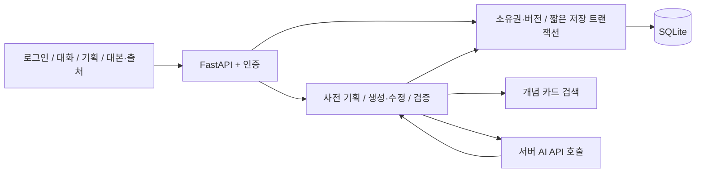

# STORY / REELS — 이론 기반 릴스 대본 코치

초보 크리에이터가 소재·시청자·연출을 정리하고 영상·미디어 이론을 참고해 장면별 대본을 작성하도록 돕는 FastAPI 웹 챗봇입니다.

**초기 통합 구현입니다.** 실제 AI 게이트웨이, 브라우저 화면, Linux 공개 배포는 별도 확인이 필요합니다. 공개 서비스 URL은 아직 없습니다. [검증 현황](docs/REELS_VERIFICATION.md)을 확인하세요.

GitHub Actions의 Linux 환경에서 코어·API·SQLite **38개 테스트가 모두 통과**했습니다. [실행 결과](https://github.com/bidulgiya999/codyssey_work_B7-1-team-/actions/runs/39225589443). 실제 AI API 호출은 대역으로 분리해 검증했습니다.

## Windows / VS Code 실행

새 실행 대상은 **app.reels_main:app**입니다. app.main:app은 가져온 기존 경제·트렌드 서비스입니다. Python 3.12를 사용합니다.

```powershell
Set-Location 'C:\Users\1234v\Documents\Codex\codyssey_work_B7-1(team_work)'
uv python install 3.12
uv venv --python 3.12
uv pip install --python .venv\Scripts\python.exe -r requirements-reels-dev.txt
Copy-Item .env.example .env
.\.venv\Scripts\python.exe -c "import secrets; print(secrets.token_hex(32))"
```

.env가 이미 있으면 복사로 덮어쓰지 마세요. 생성한 무작위 값을 .env의 SECRET_KEY에 넣고 LLM_API_KEY, LLM_BASE_URL, LLM_MODEL을 설정합니다. 실제 키는 Git·문서·채팅에 올리지 않습니다. 기본 게이트웨이·모델 이름은 기존 설정이며 현재 사용 가능 여부를 검증하지 않았습니다.

```powershell
.\.venv\Scripts\python.exe -m uvicorn app.reels_main:app --reload --host 127.0.0.1 --port 8000
```

접속: http://127.0.0.1:8000. 회원가입 → 로그인 → 새 릴스 기획 → 조건 대화 → 요약 확인 → 대본 작성 → 수정. AI 키가 없으면 오류를 안내합니다. 고정 예시를 실제 AI 응답으로 보여주는 기본 모드는 없습니다.

## 주요 기능

- 기존 bcrypt 회원가입·서명 세션 로그인 재사용. 로그인 사용자만 채팅.
- 대화방별 제작 조건과 최근 성공 Q/A 5쌍을 분리해 문맥 유지.
- 주제·목적·타겟·연령·길이·등장 방식·연출·핵심 메시지 확인. 질문은 한 번에 최대 2개.
- 요약 확인 후 장면별 대본 생성. 장면 시간·필수 필드·검색 카드 ID 검증.
- 사용자별 질문·응답·시각·실패 상태 저장, 대본 버전과 출처 추적.
- 요청 ID, AI 호출/응답/실패, DB 저장 성공·실패 로그. 본문·키·비밀번호는 이벤트 로그에서 제외.
- 대화방 버전과 DB lease로 동시 요청 제한. AI 오류 시 마지막 성공 상태 보존.



## 환경 변수

| 이름 | 설정 |
|---|---|
| SECRET_KEY | 필수 무작위 세션 서명 키. 최소 16자이며 충분히 긴 값 사용 |
| DATABASE_URL | 기본 sqlite:///./app.db. 운영은 영속 경로 |
| LLM_API_KEY | 서버에서만 사용 |
| LLM_BASE_URL / LLM_MODEL | 호환 게이트웨이·사용 가능한 모델 |
| LLM_TIMEOUT_SECONDS | 외부 HTTP timeout, 기본 50초 |
| CHAT_TOTAL_TIMEOUT_SECONDS | AI 처리 총 대기 제한, 기본 55초 |
| KNOWLEDGE_USAGE_SCOPE | educational_noncommercial 기본. commercial이면 NC 카드 제외 |
| SESSION_HTTPS_ONLY | 로컬 HTTP false, 운영 HTTPS true |
| ENABLE_API_DOCS | 기본 false. 로컬 true이면 /docs |

기존 NAVER_*는 새 서비스에서 사용하지 않습니다. .env, DB, 가상환경은 Git에서 제외하며 .env.example에는 실제 키를 쓰지 않습니다.

## 자료

[자료 목록·PDF·이용 조건·적용 방향](docs/THEORY_SOURCES.md)에 후보 6종을 정리했습니다. 김미림 교수님 자료는 원문 재사용 조건 확인 전 서지 후보로만 등록했습니다. 실제 초기 카드는 Media Studies 101 2개(CC BY 4.0), Moving Pictures 2개(CC BY-NC-SA 4.0)입니다. [출처·변경 표시](app/data/reels/ATTRIBUTION.md)를 유지합니다.

자료의 관련 개념을 검색해 모델에 제공하며 모델 가중치를 학습하지 않았습니다. 카드 검토자는 Codex initial source check이고 팀 검토 완료를 의미하지 않습니다. 짧은 영상에 적용하는 제작 제안이며 조회수 향상을 보증하지 않습니다.

## 테스트·DB 확인

```powershell
.\.venv\Scripts\python.exe -m unittest discover -s tests_reels -v
.\.venv\Scripts\python.exe scripts/check_reels_logs.py --db app.db --user-id 1
```

실제 본인 user_id를 사용합니다. 웹·DB 의존성이 없으면 API 테스트가 skip되므로 통과로 간주하지 마세요. 새 테스트는 tests_reels/, 가져온 구 서비스 테스트는 tests/입니다. 현재 증거는 [검증 현황](docs/REELS_VERIFICATION.md)에 있습니다.

## 문서·팀 협업

- [API 규격·예시](docs/REELS_API.md)
- [DB·ERD·확인 방법](docs/REELS_DATABASE.md)
- [Linux 배포](docs/REELS_DEPLOY.md)
- [A/B/C 역할과 실제 작업 내역](docs/REELS_TEAM.md)
- [기존 코드 출처](docs/UPSTREAM.md)
- [기존 README](docs/LEGACY_README.md)

main → develop → feature/c-ai-deploy에서 개발하고 PR로 통합합니다. 이번 A/B/C 초기 코드는 사용자의 요청으로 C 브랜치에서 Codex가 작성했습니다. 실제 A/B 팀원의 커밋으로 기록하지 않습니다. 개인별 유의미한 커밋 10회, PR 머지 기록, 평가 시점 외부 접속 URL은 팀의 실제 작업·검증으로 완성해야 합니다.
