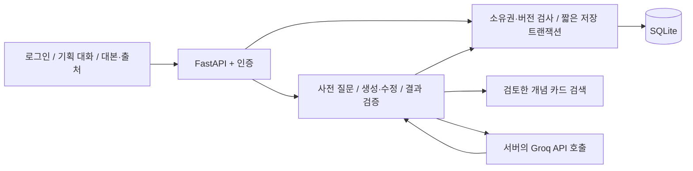

# STORY / REELS — 이론 기반 인스타 릴스 대본 코치

영상 구조·연출에 대한 이해를 바탕으로 사용자가 자신의 목적에 맞는 릴스 대본을 작성하도록 돕는 FastAPI 웹 챗봇입니다. 처음 영상을 만드는 크리에이터가 주제·시청자·등장인물·연출을 대화로 정리하고, 확인한 조건과 영상·미디어 이론을 참고해 촬영 가능한 대본을 만들도록 돕습니다.

## 핵심 시나리오

1. 회원가입·로그인 후 새 릴스 기획을 시작합니다.
2. 아이디어를 자유롭게 말하면 이미 답한 조건은 보존하고 부족한 내용을 한 번에 1~2개 묻습니다.
3. 주제·목적·타겟 세그먼트·연령·길이·등장 방식·연출·핵심 메시지를 요약합니다.
4. 사용자가 조건을 확인하면 구조 선택 이유와 장면별 화면·대사·자막·연출을 작성합니다.
5. 적용한 원리와 자료 출처를 확인하고 같은 대화방에서 대본을 수정합니다.

## 실행 — Windows / VS Code PowerShell

Python 3.12와 uv를 사용합니다. 로컬 파일과 .git은 다음 폴더에 있습니다.

```powershell
Set-Location 'C:\Users\1234v\Documents\Codex\codyssey_work_B7-1(team_work)'
uv python install 3.12
uv venv --python 3.12
uv pip install --python .venv\Scripts\python.exe -r requirements-dev.txt
Copy-Item .env.example .env
.\.venv\Scripts\python.exe -c "import secrets; print(secrets.token_hex(32))"
```

.env가 이미 있으면 덮어쓰지 마세요. 생성한 무작위 값을 SECRET_KEY에 입력합니다. [Groq Console](https://console.groq.com/home)의 API Keys에서 발급한 키를 **GROQ_API_KEY**에 넣습니다. 키는 Git·문서·채팅에 올리지 않습니다. 기본 모델은 openai/gpt-oss-20b이며 Groq에서 호스팅하는 모델입니다. 실제 사용할 수 있는 모델은 팀 계정의 목록에서 확인합니다.

```powershell
.\.venv\Scripts\python.exe -m uvicorn app.main:app --reload --host 127.0.0.1 --port 8000
```

접속: http://127.0.0.1:8000. 기본 실행 파일은 app/main.py 하나입니다. 키가 없으면 오류를 안내하며 고정 예시를 실제 AI 응답으로 보여주지 않습니다.

## 시스템 구조



bcrypt 회원가입과 HttpOnly 서명 세션을 사용합니다. 제작 조건은 최근 성공 Q/A 5쌍과 별도 저장하여 오래된 조건도 유지합니다. 질문·응답·사용자·시각·실패 상태, 대본 버전과 출처를 누적 저장합니다. 서버에서 장면 시간·필수 필드·검색 카드 ID를 검증하고 같은 대화방의 동시 요청과 오래된 버전을 차단합니다.

## 환경 변수

| 이름 | 설정 |
|---|---|
| SECRET_KEY | 필수 무작위 세션 서명 키 |
| DATABASE_URL | 기본 sqlite:///./app.db, 운영은 영속 경로 |
| GROQ_API_KEY | Groq Console에서 발급. 서버에서만 사용 |
| GROQ_BASE_URL | https://api.groq.com/openai/v1 |
| GROQ_MODEL | 기본 openai/gpt-oss-20b. 계정에서 사용 가능한 모델 |
| GROQ_TIMEOUT_SECONDS | HTTP timeout, 기본 30초 |
| GROQ_MAX_COMPLETION_TOKENS | 출력 예산, 기본 6000 |
| CHAT_TOTAL_TIMEOUT_SECONDS | AI 처리 총 대기 제한, 기본 40초 |
| KNOWLEDGE_USAGE_SCOPE | 교육용 비상업 기본. commercial이면 NC 카드 제외 |
| SESSION_HTTPS_ONLY | 로컬 HTTP false, 운영 HTTPS true |
| ENABLE_API_DOCS | 기본 false. 로컬 true이면 /docs |

.env·DB·가상환경은 Git에서 제외합니다. 예시에는 실제 키가 없습니다. JSON Object Mode로 응답을 요청하고 별도 서버 검증을 수행합니다. 429 한도 초과·timeout·공급자 오류·잘못된 응답을 사용자에게 안내하며 무제한 재시도하지 않습니다. [Groq 호환 규격](https://console.groq.com/docs/openai), [JSON 출력 안내](https://console.groq.com/docs/structured-outputs).

## 이론 자료

[자료 목록·PDF·이용 조건·적용 방향](docs/THEORY_SOURCES.md)에 후보 6종을 정리했습니다. 김미림 교수님 자료는 원문 재사용 조건 확인 전 서지 후보로 등록했습니다. 초기 검색 카드는 Media Studies 101 2개(CC BY 4.0), Moving Pictures 2개(CC BY-NC-SA 4.0)입니다. [출처·변경 표시](app/data/reels/ATTRIBUTION.md)를 유지합니다.

자료를 검색해 프롬프트에 제공하는 방식이며 모델 가중치를 학습하지 않았습니다. 초기 카드 검토자는 Codex initial source check이며 팀원의 검토 완료를 뜻하지 않습니다. 원리의 짧은 영상 적용은 제작 제안이며 조회수 향상을 보증하지 않습니다.

## 검증·DB 확인

```powershell
.\.venv\Scripts\python.exe -m unittest discover -s tests -v
.\.venv\Scripts\python.exe scripts/check_reels_logs.py --db app.db --user-id 1
```

실제 본인 user_id를 사용하세요. 테스트는 실제 외부 AI 호출을 대역으로 분리합니다. API·SQLite 통합 테스트는 서버 의존성이 필요하며 skip을 통과로 계산하지 않습니다. 최신 실행 증거는 [검증 문서](docs/VERIFICATION.md)에 기록합니다. 실제 Groq 응답 품질·브라우저 화면·외부 공개 배포는 아직 확인이 필요합니다.

## 기술 문서·협업

- [API 요청·응답과 A/B/C 연결 규격](docs/API.md)
- [제공한 이미지의 8개 연구 주제와 챗봇 적용](docs/RESEARCH_AGENDA.md)
- [Groq Console 설정](docs/GROQ.md)
- [DB·ERD·조회 가이드](docs/DATABASE.md)
- [Linux 배포·환경 변수](docs/DEPLOY.md)
- [팀 역할·실제 작업 내역](docs/TEAM.md)
- [기존 코드 출처](docs/UPSTREAM.md)

main → develop → feature/c-ai-deploy에서 작업하고 PR로 통합합니다. 사용자의 요청으로 C 브랜치에서 A/B/C 초기 코드를 Codex가 함께 작성했습니다. A/B 팀원의 직접 기여로 기록하지 않습니다. 팀원별 유의미한 커밋 10회·실제 PR 머지·평가 시점 공개 서비스 URL은 팀의 실제 작업으로 완성해야 합니다.
