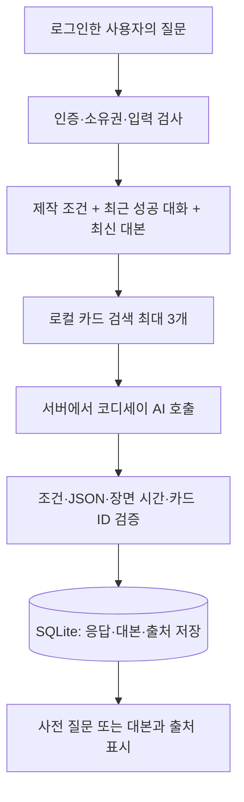

# 챗봇이 사용하는 데이터와 처리 흐름

이 서비스는 인스타 릴스 제작 조건을 대화로 정리하고 영상·미디어 이론을 참고해 대본과 연출안을 만드는 코치다. 현재 구현은 **검토한 한국어 개념 카드를 검색해 AI 요청에 제공하는 방식**이다. PDF 전체를 모델에 학습시키거나 모델 가중치를 변경하지 않았다.

## 실제 데이터 구성

| 데이터 | 현재 규모·위치 | 사용하는 목적 |
|---|---|---|
| 출처 목록 | [sources.json](../app/data/shortform/sources.json), 후보 15종 | 저자·제목·원문/PDF URL·라이선스·확인 범위 관리. 공개 자료 12종 사용, 김미림 교수 관련 3종 보류 |
| 한국어 개념 카드 | [cards.jsonl](../app/data/shortform/cards.jsonl), 21개 | 개념 요약·관련 절/확인한 PDF 쪽수·태그·별칭·적용 제안·한계를 검색하여 제공 |
| 연구 의제 | [research_agenda.json](../app/data/shortform/research_agenda.json), 8개 | 제공한 이미지의 연구 질문을 연결. 연구 결과나 효과 입증 자료로 취급하지 않음 |
| 제작 구성안 | [structures.py](../app/services/shortform/structures.py), 4유형 | 시연·공감·설명·관찰에 맞는 제작 제안. 학술 이론이나 전문가 검증 결과와 구분 |
| 사용자 제작 조건 | SQLite의 대화방별 Brief | 주제·목적·시청자 세그먼트와 연령·길이·등장 방식·연출·핵심 메시지 보존 |
| 대화와 대본 | SQLite의 사용자별 대화방·턴·대본 버전 | 같은 사용자의 같은 대화방에서 최근 성공 Q/A 최대 5쌍과 최신 대본을 AI 맥락에 제공 |

현재 카드는 Codex의 초기 출처 검토·요약으로 구성했다. 데이터의 approved 상태는 검색 허용 상태이며 A/B/C 팀원의 검토 완료를 의미하지 않는다. 교수님 자료 3종은 원문 재사용 조건이 확인되지 않아 검색·프롬프트에서 제외한다.

## 어떤 이론 자료를 쓰는가

| 공개 자료 | 참고하는 개념 | 대본·연출 적용 예 |
|---|---|---|
| Sharman, Moving Pictures | 서사·미장센·몽타주·연속 편집·리듬·소리 | 장면의 목적, 쇼트 연결, 행동과 소리의 관계 설계 |
| Media Studies 101 | 이용과 충족·프레이밍 | 누가 왜 보는지 먼저 묻고 메시지 관점 정하기 |
| Hoek, Tools for Shaping Stories? | 플롯 모델·프라이타크와 3막의 차이 | 소재와 길이에 맞는 구조 선택, 모든 영상에 3막을 강제하지 않기 |
| Curiosity or savouring? / Confronting a Paradox | 정보 격차·호기심·서스펜스 | 초반에 제시할 질문과 정보를 공개할 시점 검토 |
| Two types of redundancy / Noba Attention | 인지부하·중복·선택적/분산된 주의 | 한 장면의 정보량과 화면·대사·자막의 중복 점검 |
| Elements of Creative Writing: Show and Tell | 보여주기와 설명의 균형 | 추상적 설명을 촬영할 수 있는 행동과 화면으로 바꾸기 |
| The Prompt Report | 과제 분해·검색 활용·평가 | 사전 조건 수집, 구조 선택, 장면 작성, 결과 검증 분리 |
| Tacit knowledge elicitation process | 암묵지 추출·지식 표현 | 제작 판단의 이유를 명시적 규칙으로 정리하는 방법 참고 |
| Aesthetic Pleasure versus Aesthetic Interest / Noba Creativity | 처리 유창성·흥미·독창성·유용성 | 화면의 이해 가능성과 새로움에 대한 수정 질문 구성 |

전체 12종의 링크·PDF 제공 여부·이용 조건은 [자료 목록](KNOWLEDGE.md), 출처 및 변경 표시는 [ATTRIBUTION](../app/data/shortform/ATTRIBUTION.md)에 있다. 교육·심리·소설·산업 연구를 릴스 제작에 적용하는 부분은 제작 제안이다. 이 자료만으로 완주율·영상 품질 향상이나 플랫폼 정책 준수를 입증하지 않는다.

## 요청 한 번이 처리되는 순서

1. 로그인 상태와 대화방 소유권을 검사하고, 빈 질문·길이·대화방 버전 등 입력을 검증한다.
2. 저장된 제작 조건, 같은 대화방의 최근 성공 Q/A 최대 5쌍, 최신 대본을 읽는다. 다른 사용자의 기록이나 실패 응답을 대화 맥락으로 사용하지 않는다.
3. 현재 질문의 개념 이름·한국어/영어 별칭·태그를 중심으로 검색하고 기존 제작 조건을 보조 맥락으로 사용한다. 관련 카드 **최대 3개**를 선택한다. 벡터 DB나 임베딩을 사용하는 검색은 아니다.
4. 제작 조건과 대화, 검색 카드의 요약·적용 제안·한계, 출력 규격을 서버에서 코디세이 AI에 전달한다. 조건이 완성되고 생성/수정을 요청하면 4개 제작 구성안 중 적합한 후보 최대 2개도 제공한다.
5. 부족한 조건이 있으면 한 번에 최대 2개 질문한다. 조건이 갖춰지면 요약하고 사용자 확인을 받는다. 확인 후 장면별 시간·화면·대사·자막·연출·적용 이유를 작성한다.
6. 서버는 AI의 JSON과 필수 필드, 장면의 시간 연결·총 길이, 실제 검색한 카드 ID를 검증한다. 검색하지 않은 출처 ID를 근거로 받아들이지 않는다. 이 검사는 모든 문장의 사실성·인용 적합성을 보증하는 검사는 아니다.
7. 출처 목록에서 저자·원문 링크·관련 절/확인한 PDF 쪽수·라이선스를 결합한다. 질문·응답·시각·사용자 연결·대본 버전·출처를 SQLite에 저장하고 화면에 반환한다.
8. 타임아웃·공급자 오류·형식 오류·저장 실패는 오류 코드와 안내를 반환하고 서버 로그에 남긴다. 실패를 성공 대본으로 저장하거나 다음 대화의 성공 맥락에 섞지 않는다.



예를 들어 “20대 대학생을 위한 책상 정리 30초 릴스”라고 말하면 목적·등장 방식·연출·핵심 메시지 중 빠진 조건을 먼저 묻는다. 사용자가 조건을 확인한 뒤 촬영할 행동과 화면, 대사·자막을 작성하고, 검색된 자료가 있다면 적용 이유와 출처를 함께 표시한다. 어떤 카드가 선택되는지는 실제 질문과 누적 조건에 따라 달라진다.

## 데이터 전달·보관 범위

- 사용자가 작성한 질문·제작 조건·최근 대화·최신 대본과 검색된 자료 요약은 답변을 위해 설정된 외부 코디세이 API에 전달된다. 로컬 DB에만 남는다는 뜻이 아니다. 이 앱이 별도로 파인튜닝 학습 작업을 수행하지는 않는다. 공급자의 보관·학습 정책까지 이 코드로 확정할 수는 없다.
- 비밀번호는 해시로 보관한다. 비밀번호·세션 서명 키·DB 사용자 식별자를 AI 프롬프트에 넣지 않는다. API 키는 서버의 인증 헤더에만 사용한다.
- .env·SQLite DB·가상환경·로컬 검증 결과는 Git에서 제외한다. 공개 저장소에는 출처 목록·개념 카드·코드·문서가 올라간다.
- 앱 시작 시 출처 권리 상태·허용 라이선스·카드 검토 상태·위치 정보를 확인한다. commercial 설정에서는 NC 자료를 검색에서 제외한다. 자료를 추가할 때에도 원문별 이용 조건과 별도 권리 예외를 검토해야 한다.

## 현재 지원하지 않는 데이터 처리

원본 PDF 파일 전체를 로컬에 보관하거나 OCR·자동 청킹·임베딩·파인튜닝하지 않는다. 답변할 때마다 웹/PDF를 새로 읽거나 인스타그램 데이터를 긁어오지도 않는다. URL은 출처 확인 경로이며 현재 모델에 제공하는 본문은 검토한 카드 내용이다. 추가 PDF·강의자료는 이용 조건 확인 → 필요한 절 검토 → 출처와 적용 한계를 갖춘 카드 작성 → 팀 검토 → 검색 검증 순서로 연결한다.

## 키 없이 확인하는 방법

프로젝트 폴더에서 다음 명령으로 실제 검색 결과를 확인할 수 있다. API 호출이나 유료 모델 요청은 발생하지 않는다.

```powershell
.\.venv\Scripts\python.exe scripts/check_knowledge.py --query '프라이타크와 3막'
.\.venv\Scripts\python.exe scripts/check_knowledge.py --query '인지 부하' --scope commercial
```

구현은 [knowledge.py](../app/services/shortform/knowledge.py), [coach.py](../app/services/shortform/coach.py), [대화 저장 서비스](../app/services/shortform/store.py), [채팅 라우터](../app/routers/shortform.py)를 참고한다.
